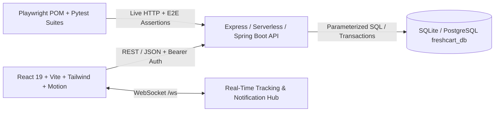
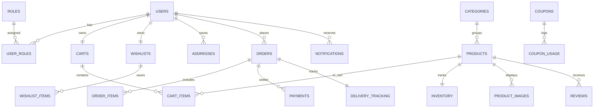

# FreshCart — Academic Project & Automated Testing Documentation

## 1. Project Abstract
FreshCart is a full-stack online grocery shopping platform combining an expressive animated user interface (featuring a 5-rider reactive scooter delivery character, a dashboard marquee scooter with touch lights/horn/engine SFX, and free delivery above ₹99) with transactional backend workflows, role-based access control, real Google OAuth sign-in, real-time geolocation + Google Maps Routes API delivery tracking with simulated vehicle animation, WebSocket updates, and automated Playwright + Pytest test suites.

## 2. System Architecture

## 3. Entity Relationship Diagram (21 Tables)

## 4. Automated Test Plan & 53-Case Coverage Matrix
- **Suite 1 — Authentication (`TC001–TC010`)**: Valid/invalid login, empty/malformed email, wrong password, registration, duplicate email detection, password hash non-disclosure, password reset, token revocation on logout.
- **Suite 2 — Product Catalog (`TC011–TC016`)**: Live search, empty search, category filtering, price range filtering, price sorting, out-of-stock protection.
- **Suite 3 — Shopping Cart (`TC017–TC022`)**: Add item, increase/decrease quantity, server subtotal/tax/delivery math, stock limit enforcement, item removal.
- **Suite 4 — Wishlist (`TC023–TC025`)**: Add, move to cart, delete.
- **Suite 5 — Coupons (`TC026–TC029`)**: Valid percentage/fixed coupon, invalid code, expired coupon, minimum purchase validation.
- **Suite 6 — Checkout (`TC030–TC034`)**: Address creation, invalid mobile rejection, missing address rejection, server order calculation, idempotent duplicate order prevention.
- **Suite 7 — Payments (`TC035–TC039`)**: Sandbox success verification, simulated failure, cancellation, duplicate payment prevention, unknown transaction rejection.
- **Suite 8 — Orders & Tracking (`TC040–TC044`)**: Order history, detail inspection, live tracking timeline, reorder, order cancellation with atomic inventory rollback.
- **Suite 9 — Admin RBAC (`TC045–TC048`)**: Unauthorized customer block (403), aggregate KPIs, inventory adjustment, live status broadcast.
- **Suite 10 — Security & Boundary (`TC049–TC053`)**: SQL injection immunity, XSS character sanitization, unauthenticated access denial (401), negative/zero quantity rejection, price tampering protection.
